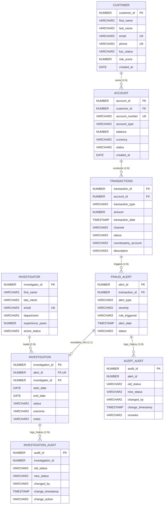

# FraudLens: Entity-Relationship (ER) & Relational Schema Architecture

**Case Study**: FraudLens — Financial Transaction & Fraud Investigation Management System  
**Academic Level**: B.Tech CSE — Database Management Systems (DBMS)  
**Database Dialect**: Oracle Database 11g / 12c / 19c / 21c / 23c Compatible  

---

## 1. Domain Conceptual Overview

In modern fintech and retail banking operations, fraud detection systems must balance high-throughput transaction processing with strict regulatory compliance, auditable forensics, and triage workflows. 

**FraudLens** decouples transaction generation from anomaly alerting and investigator case management:
1. **Customers** maintain one or more banking **Accounts** (Savings, Current, Salary, NRI).
2. Customers perform monetary **Transactions** across multiple digital channels (UPI, Net-Banking, Mobile App, ATM, POS).
3. Automated heuristic rules evaluate transactions in near real-time. Transactions violating risk thresholds (e.g., amount $> ₹50,000$ or suspicious velocity) trigger a **Fraud Alert**.
4. **Fraud Alert is a signal for investigation, not proof of fraud.**
5. High-severity alerts are formally escalated into an **Investigation**, assigned to a specialized forensic **Investigator**.
6. The case lifecycle follows strict operational progression: `OPEN` $\rightarrow$ `UNDER REVIEW` $\rightarrow$ `CLOSED`.
7. Auditing triggers monitor state transitions to ensure tamper-proof evidence logs.

---

## 2. Mermaid Entity-Relationship Diagram

---

## 3. Relational Schema & Cardinality Specifications

### Table: `CUSTOMER`
* **Primary Key**: `customer_id`
* **Alternate / Unique Keys**: `email`, `phone`
* **Check Constraints**: 
  * `kyc_status IN ('VERIFIED', 'PENDING', 'REJECTED')`
  * `risk_score BETWEEN 0 AND 100`
* **Defaults**: `kyc_status = 'PENDING'`, `risk_score = 10`, `created_at = SYSDATE`

### Table: `ACCOUNT`
* **Primary Key**: `account_id`
* **Foreign Key**: `customer_id` $\rightarrow$ `CUSTOMER(customer_id)` (`ON DELETE CASCADE`)
* **Alternate / Unique Keys**: `account_number`
* **Check Constraints**: 
  * `account_type IN ('SAVINGS', 'CURRENT', 'SALARY', 'NRI')`
  * `balance >= 0`
  * `status IN ('ACTIVE', 'FROZEN', 'DORMANT', 'CLOSED')`
* **Defaults**: `account_type = 'SAVINGS'`, `balance = 0.00`, `currency = 'INR'`, `status = 'ACTIVE'`
* **Cardinality**: `CUSTOMER (1) <---> (N) ACCOUNT`

### Table: `TRANSACTIONS`
* **Primary Key**: `transaction_id`
* **Foreign Key**: `account_id` $\rightarrow$ `ACCOUNT(account_id)` (`ON DELETE CASCADE`)
* **Check Constraints**: 
  * `transaction_type IN ('DEPOSIT', 'WITHDRAWAL', 'TRANSFER', 'PAYMENT')`
  * `amount > 0`
  * `channel IN ('MOBILE_APP', 'NET_BANKING', 'ATM', 'POS', 'UPI')`
  * `status IN ('COMPLETED', 'PENDING', 'FLAGGED', 'FAILED')`
* **Defaults**: `status = 'COMPLETED'`, `transaction_date = SYSTIMESTAMP`
* **Cardinality**: `ACCOUNT (1) <---> (N) TRANSACTIONS`

### Table: `FRAUD_ALERT`
* **Primary Key**: `alert_id`
* **Foreign Key**: `transaction_id` $\rightarrow$ `TRANSACTIONS(transaction_id)` (`ON DELETE CASCADE`)
* **Check Constraints**: 
  * `alert_type IN ('HIGH_AMOUNT', 'RAPID_VELOCITY', 'SUSPICIOUS_CHANNEL', 'UNUSUAL_HOURS', 'CROSS_BORDER', 'STRUCTURING')`
  * `severity IN ('LOW', 'MEDIUM', 'HIGH', 'CRITICAL')`
  * `status IN ('PENDING', 'ESCALATED', 'DISMISSED', 'RESOLVED')`
* **Defaults**: `severity = 'MEDIUM'`, `status = 'PENDING'`, `alert_date = SYSTIMESTAMP`
* **Cardinality**: `TRANSACTIONS (1) <---> (N) FRAUD_ALERT`

### Table: `INVESTIGATOR`
* **Primary Key**: `investigator_id`
* **Alternate / Unique Keys**: `email`
* **Check Constraints**: 
  * `experience_years >= 0`
  * `active_status IN ('ACTIVE', 'INACTIVE')`
* **Defaults**: `experience_years = 0`, `active_status = 'ACTIVE'`

### Table: `INVESTIGATION`
* **Primary Key**: `investigation_id`
* **Foreign Keys**: 
  * `alert_id` $\rightarrow$ `FRAUD_ALERT(alert_id)` (`ON DELETE CASCADE`, `UNIQUE`)
  * `investigator_id` $\rightarrow$ `INVESTIGATOR(investigator_id)`
* **Check Constraints**: 
  * `status IN ('OPEN', 'UNDER REVIEW', 'CLOSED')`
  * `outcome IN ('CONFIRMED_FRAUD', 'FALSE_POSITIVE', 'INCONCLUSIVE', 'PENDING')`
  * `end_date IS NULL OR end_date >= start_date`
* **Defaults**: `status = 'OPEN'`, `outcome = 'PENDING'`, `start_date = SYSDATE`
* **Cardinality**: 
  * `FRAUD_ALERT (1) <---> (1) INVESTIGATION`
  * `INVESTIGATOR (1) <---> (N) INVESTIGATION`

### Table: `INVESTIGATION_AUDIT` & `ALERT_AUDIT`
* **Primary Key**: `audit_id`
* **Operational Purpose**: Immutable event stream populated strictly by PL/SQL row-level triggers (`AFTER UPDATE OF status`).

---

## 4. Normalization Analysis

* **First Normal Form (1NF)**: Every attribute contains only atomic, indivisible values. All tables possess explicitly defined single-column primary keys.
* **Second Normal Form (2NF)**: All primary keys consist of a single column (`customer_id`, `account_id`, etc.), eliminating partial functional dependencies entirely.
* **Third Normal Form (3NF)**: Transitive dependencies are removed. Investigator department information is stored with the investigator, account balances are kept on accounts, and transaction details are strictly isolated from customer demographic attributes.
